<div align="center">



<br>


</div>

<br>

## `> whoami`

<div align="center">

</div>

<br>

## `> about`

I'm a **web developer turned cybersecurity learner**. I learn by building: every concept I study becomes a small tool I can run, break and improve.

- 🎯 **Goal**: a career in cybersecurity, built on top of my web development background
- 🔬 **Interests**: digital forensics, network security, applied cryptography
- 🧪 **Method**: build a tool, document it, learn from the mistakes, repeat
- 🏠 **Playground**: a budget-friendly homelab for hands-on practice
- 🌱 **Currently learning**: Rust, Go, and low-level file analysis

<br>

## `> arsenal`

| Domain | Tools & languages |
| :-- | :-- |
| **Languages** | Python, Go, Rust, JavaScript, HTML/CSS |
| **Networking** | Host discovery, port scanning, IPv4/IPv6 subnetting |
| **Forensics** | Deleted file recovery, magic bytes, file signature analysis |
| **Cryptography** | Local encrypted storage, password vault design |
| **Environment** | Windows (heavily customized), Linux, homelab |

<br>

## `> missions`

| Project | What it does | Stack |
| :-- | :-- | :-- |
| 👻 [**GhostZ**](https://github.com/USERNAME/ghostz) | Digital forensics tool that recovers deleted files from an SSD | `Go` |
| 🔍 [**SigZ**](https://github.com/USERNAME/sigz) | Identifies the real type of a file using magic bytes, ignoring its extension | `Rust` |
| 📡 [**PortZ**](https://github.com/USERNAME/portz) | Port scanner to audit and secure a home network | `Python` |
| 🌐 [**NetScan**](https://github.com/USERNAME/netscan) | Lists every device connected to the local network | `Python` |
| 🔐 [**VaultZ**](https://github.com/USERNAME/vaultz) | Local encrypted vault and password manager for the terminal | `Python` |
| 🧮 [**Subnet Calculator**](https://github.com/USERNAME/subnet-calculator) | Open-source IPv4/IPv6 subnet calculator CLI | `Python` |

<br>

## `> roadmap`

- [x] Ship a first forensics tool (GhostZ)
- [x] Learn a second systems language (Rust, through SigZ)
- [x] Build a network scanning toolkit
- [ ] Publish a series of CTF write-ups
- [ ] Earn an entry-level security certification
- [ ] Land a first role in cybersecurity

<br>

## `> stats`

<div align="center">


</div>

<br>

## `> contact`

- 💻 GitHub: [@USERNAME](https://github.com/USERNAME)
- 🌍 Portfolio: [your-portfolio.example](https://your-portfolio.example)
- ✉️ Email: your.email@example.com

<br>

<div align="center">

```bash
echo "Stay curious. Stay ethical."
```

<sub>All tools in my repositories are built for education and for use on systems I own or am explicitly authorized to test.</sub>

</div>
